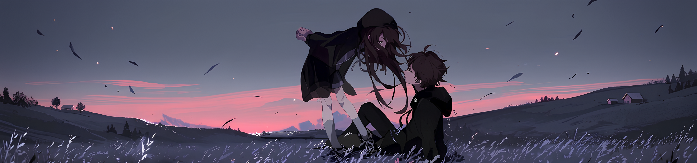
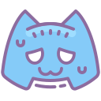

  
   
   
  

---

### About Me
- 3rd-semester B.Tech Computer Science student.
- Currently building **Attendr** (React Native) and scaling **AniKehai**.
- Passionate about crafting minimal user experiences.
- When I'm offline, I'm usually playing CS2 or grinding Minecraft.

 

<h3 align="">Tech Stack</h3>

  <a href="https://skillicons.dev">
    
     
    
  </a>

 

<h3 align="">Projects</h3>
<table align="" style="border-collapse: collapse; border: none;">
  <tr style="border: none;">
    <td align="center" style="border: none; padding: 0 30px;">
      <a href="https://github.com/minkxx/kaiwa" style="text-decoration: none;">
         
        <b>Kaiwa</b>
      </a>
    </td>
    <td align="center" style="border: none; padding: 0 30px;">
      <a href="https://github.com/minkxx/AniKehai" style="text-decoration: none;">
         
        <b>AniKehai</b>
      </a>
    </td>
  </tr>
</table>

 

<h3 align="">GitHub Analytics</h3>

<table align="" border="0" cellpadding="0" cellspacing="0" style="border-collapse: collapse; border: none;">
  <tr style="border: none; background: transparent;">
    <td align="center" style="border: none; background: transparent; padding: 10px;">
      
    </td>
    <td align="center" style="border: none; background: transparent; padding: 10px;">
      
    </td>
  </tr>
  <tr style="border: none; background: transparent;">
    <td align="center" style="border: none; background: transparent; padding: 10px;">
      
    </td>
    <td align="center" style="border: none; background: transparent; padding: 10px;">
      
    </td>
  </tr>
</table>